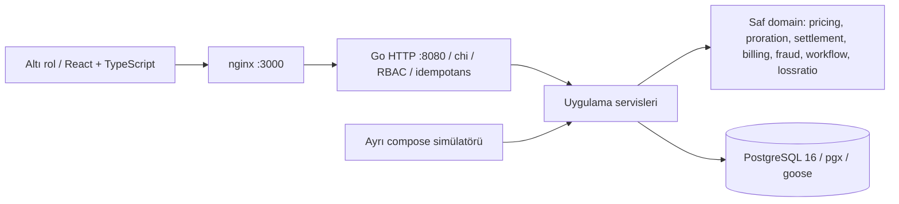
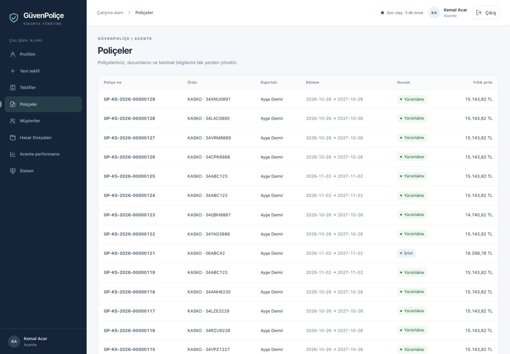
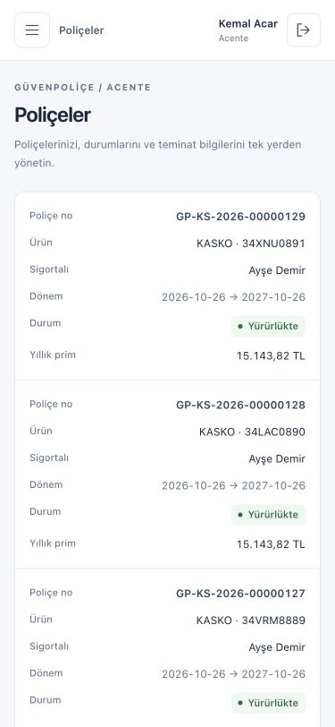

# GüvenPoliçe

**Aday: Enes Göker · GitHub: [EnesGoker](https://github.com/EnesGoker)**

[](https://github.com/EnesGoker/ddo-case-enes-goker/actions/workflows/ci.yml)

Kasko, trafik ve konut teklifinden poliçe, zeyil, tahsilat ve hasar ödemesine kadar çalışan Go/PostgreSQL uygulaması. Altı rol aynı React uygulamasını kullanır; yetki ve kayıt kapsamı sunucuda da denetlenir. Bütün kişi/veri, tarife, faiz, SLA, sahtecilik eşikleri ve olay limitleri **kurgusal demo varsayımlarıdır**; gerçek ürün tarifesi veya mevzuat iddiası yoktur.

## Kurulum

Docker Desktop ve Docker Compose gerekir. Veritabanı host portuna açılmaz.

```bash
git clone https://github.com/EnesGoker/ddo-case-enes-goker.git
cd ddo-case-enes-goker
cp .env.example .env
docker compose up --build -d --wait
make verify
```

Web: [localhost:3000](http://localhost:3000) · API: [localhost:8080](http://localhost:8080) · [OpenAPI](openapi.yaml) · [HTTP örnekleri](requests.http).
Migration ve seed API açılırken otomatik çalışır. `.env.example` yalnız değiştirilebilir demo değerleridir; `.env` Git'e girmez. İnternete açık dağıtım için demo parolasını/JWT anahtarını değiştirip HTTPS/secure cookie yapılandırması gerekir.

Simülatör tek seferlik bir iş olduğu için healthcheck'i kapalıdır; DB/API/web healthcheck kullanır, API → DB ve web → API bağımlılıkları `service_healthy` koşuluyla kurulur ([Compose: simülatör](docker-compose.yml#L75-L80), [API](docker-compose.yml#L48-L58), [web](docker-compose.yml#L83-L94), [DB](docker-compose.yml#L13-L17)).

| Rol | Demo hesabı | Deneme yolu |
|---|---|---|
| Müşteri | musteri@guvenpolice.test | Kendi poliçesi, hasar bildirimi/geçmişi, ödeme |
| Acente | acente@guvenpolice.test | Müşteriler → yeni teklif → prim dökümü → poliçe |
| Underwriter | underwriter@guvenpolice.test | Onay bekleyen teklifler → karar; rapor/Sistem özeti |
| Ekspertiz | eksper@guvenpolice.test | Ekspertiz bekleyen dosya → değerlendirme |
| Hasar uzmanı | hasar@guvenpolice.test | İş kuyruğu → geçiş/inceleme → tazminat onayı |
| Muhasebe | muhasebe@guvenpolice.test | Tahsilat/iade, gün sonu, tazminat ödemesi, mizan |
| Ek eksper | eksper2@guvenpolice.test | Görevi devralma/iş yükü karşılaştırması |
| Ek hasar uzmanı | hasar2@guvenpolice.test | Dağıtılmış görev ve SLA |

Hepsinin parolası `.env` içindeki `DEMO_PASSWORD`; örnek dosyada `Demo-Parola-2026`. Kurgusal Ayşe Demir müşteri hesabına bağlıdır. İkinci uzman hesapları altı rolün dışında yeni bir rol oluşturmaz.

## Mimari ve kararlar



Tek süreçli modüler monolit; HTTP handler → servis → saf hesap + repository. Go 1.27.3 (`go.mod` kaynak), chi, pgx v5, goose ve testify; ORM/kuyruk/mikroservis yok. React/TypeScript/Vite tek uygulamada ortak form ve rol akışını paylaşır; nginx statik çıktı ve aynı origin API yönlendirmesi sağlar. Tek repo küçük teslimin kurulumunu ve transaction sınırlarını görünür tutar. Kararların ayrıntısı [DECISIONS.md](DECISIONS.md).

Para `int64` kuruş; oranlar tamsayı bp/ppm. Poliçe/tarife sürümleri geçmişi korur; tarih aralıkları `[başlangıç, bitiş)` ve artık yıl testleriyle doğrulanır. Gün sonu imleçli parçalarla, her poliçe ayrı transaction içinde ilerler. Servis saati yalnız seed/simülatör bağlamında tarihsel olabilir; HTTP yolları gerçek zamanı kullanır.

Tahsilat önce poliçeyi, hasar onayı hasarı ve limit bakiyesini kilitler; limit tüketimi koşullu UPDATE ile yapılır. Defterde her iş kaydı dengeli satırlarla aynı transaction'dadır. Audit append-only'dir. Mutasyon yapan kritik mali uçlarda Idempotency-Key ve iş anahtarı veya kaynak durum/kısıt koruması vardır; ekspertiz de 00013 ile iş anahtarına bağlanmıştır. Kurtarmanın uç bazlı kapsamı ADR-14'te yazılıdır. `/metrics` yalnız kimliği doğrulanmış ACCOUNTING/UNDERWRITER rollerine açıktır; sağlık denetimi `/health` kullanır.

Muhasebe hesabıyla giriş yapıp access token ile `/metrics` okuma (`DEMO_PASSWORD` ortamda tanımlı olmalıdır; [giriş ve başlık örneği](requests.http#L166-L175)):

```bash
curl -fsS http://localhost:8080/metrics -H "Authorization: Bearer $(curl -fsS -X POST http://localhost:8080/api/v1/auth/login -H 'Content-Type: application/json' --data "{\"email\":\"muhasebe@guvenpolice.test\",\"password\":\"$DEMO_PASSWORD\"}" | sed -n 's/.*"access_token":"\([^"]*\)".*/\1/p' | head -n 1)"
```

Tazminat sırası **muafiyet → olay başı limit → teminat dönem limiti → yıllık toplam limit**. CAM için örnek olay limiti 10.000 TL, dönem limiti 25.000 TL, muafiyet 500 TL'dir. Olay limiti her dosyaya yeniden uygulanır; dönem/yıllık tüketim ayrı tutulur. Eski sözleşmelerde NULL olay limiti yok anlamındadır; güncel katalog geçmiş sözleşmeyi değiştirmez.

Müşteri/acente hasarında iç durum UNDER_REVIEW olarak görünür; iç inceleme/sistem notları gizlenir, red gerekçesi müşteriye gösterilir. İç rollerin görünümü korunur. Sistem mali özeti muhasebe/UW'ye; diğer rollere yalnız sayısal canlılık verilir.

### Ekran görüntüleri




Masaüstü ve 375 px mobil görüntüler, altı rolün paylaştığı arayüz dilini gösterir.

### Acente performansı (B1)

Acente kendi satırını; underwriter ve muhasebe bütün acenteleri, varsa **Acentesiz** satırını ve toplamı görür. Dönem dışı/faaliyetsiz acenteler sıfırlarla listelenir. Prim sıfırsa oran “—”; genel oran toplamlardan hesaplanır. Menüde **Acente performansı**, iki tarih alanı ve sütun başlıklarıyla sıralama vardır. Varsayılan TRT bugün dahil son 12 ay; iki tarih boşaltılınca tüm zamanlar. Tarih aralığı yevmiye entry_date üzerinde [başlangıç, bitiş) şeklindedir; kazanılmış prim hesabı yoktur. Poliçe adedi ve ilk yazılan primin dönem tarihi ADR-18’deki gibi poliçe başlangıcıdır; bugün düzenlenip ileri tarihte başlayacak poliçe, başlangıç gününe kadar varsayılan panonun ilk üretimine girmez (zeyil/iptal ve hasar onayları kendi yevmiye entry_date tarihleriyle hesaba katılır).

| Uç | Erişim / kapsam |
|---|---|
| `GET /api/v1/reports/agents` | AGENT kendi satırı; UNDERWRITER/ACCOUNTING bütün satırlar ve toplam; diğer roller 403, kimliksiz 401 |
| `GET /api/v1/reports/agents?from=&to=` | Aynı yetkiyle tüm zamanlar |

| Şartname maddesi | Kanıt |
|---|---|
| §10 bonus: acente performans panosu | `TestAgentPerformanceGolden` hazır satırlarda toplam/oranı; `TestProductionReportGoldenLedgerPeriodsAndGroups` gerçek SQL ve zeyil/iptal/onay sonrası acente satırlarını; `TestAgentPerformanceAccessAndGoldenRows` rol/nakit iade/tarih sınırını doğrular; verify `B1 acente-panosu`; ayrıntılar [TESTING B1](TESTING.md#b1--acente-performans-panosu) |

Yeni sorgu kaynakları acente bazında ayrı toplar; mevcut ADR-18 raporu değişmez. 100k SIM verisinde tüm zamanlar medyanı **501,841 ms**, son 12 ay **257,549 ms** (üçer EXPLAIN ölçümü, yeni indeks yok). İlk tüm-zamanlar örneği 2113,342 ms; medyan kapısı PASS olsa da her isteğin 1 sn altında olduğu iddia edilmez. [Ham ölçümler](docs/explain/b1-after.json), [sorgu](docs/explain/b1-after.sql), [üç dönem tutarlılığı](docs/testing/b1-consistency.json), [ADR-27](DECISIONS.md#adr-27--acente-performans-panosu-b1). B1.1 kod commit’i `c374d9b` üzerinde birim/lint/build ve entegrasyon PASS; verify **64 PASS / 0 FAIL, 116,196 sn**. Yenilenen gerçek HTTP tüm zamanlar/12 ay medyanı **461,028 / 259,123 ms**; [dört metrik eşitliği](docs/testing/b1-http-consistency.json), [100k koruması](docs/testing/b1-comparison.json) ve [tarayıcı kabulü](docs/testing/b1-ui.json) kayıtlıdır. HTTP kanıtını `python3 scripts/check-agent-performance.py` üretir; 100k ortamında AGENT kapsamlı sorgunun tüm zamanlar/12 ay medyanı **3,090 / 1,525 ms** ([planlar](docs/explain/b11-agent.json)).

### Arayüz

Altı rolün ekranları ortak tasarım dili, erişilebilir mobil menü ve tutarlı form, tablo ve detay düzeni kullanır. API, hesaplar, yetki ve iş akışları değişmedi. Kabul kanıtı [arayüz doğrulama özetinde](docs/testing/ui1/README.md) yer alır.

## Doğrulama

```bash
make test                  # Go birim testleri
make coverage              # sekiz saf domain paketinin her birinde >=%70
make test-integration      # geçici PostgreSQL16, normal integration testleri
make test-simulation       # integration,simulation; ayrı ölçek/determinizm kabulü
make lint                  # go vet üç etiket modu + ESLint
make build                 # Go + TypeScript/Vite
make verify                # çalışan sisteme gerçek HTTP + DB etkileri
make load                  # resmî, digest sabitli grafana/k6 Docker imajı
make chaos                 # kontrollü DB kesintisi/iyileşmesi
make explain               # iki kritik indeks + ikinci aday karşılaştırması
```

Birim/lint için Go, frontend build/lint için Node 20 gerekir; yük testi host k6 kurulumu gerektirmez. Betikler Bash/curl kullanır; kaos/EXPLAIN ve macOS verify nanosaniye saati Python3 standart kütüphanesini kullanır. Entegrasyon testleri kendi geçici DB'sini açar; `DATABASE_URL` verilirse verilen sunucuda ayrı test veritabanları oluşturur. Üretim veritabanını bu değişkene vermeyin.

26 Ekim A8: havuz düzeltmesinden sonra normal entegrasyon **PASS, 79,391 sn**, birim/vet/frontend lint/build PASS. Olay limiti öncesi yerel pencere kabul paketi (üretici3) **PASS, 643,392 sn**; son üretici4 simülasyon işi de CI'da PASS. Güncel domain kapsamı:

| Paket | Statement kapsamı |
|---|---:|
| billing | %92,1 |
| caldate | %100 |
| pricing | %95,5 |
| proration | %97,8 |
| settlement | %100 |
| fraud | %100 |
| workflow | %100 |
| lossratio | %100 |

[CI gerçek kapsam çıktısı](docs/testing/ci-domain-coverage.md). CI, her paketin %70 eşiğini ayrı uygular; `GITHUB_STEP_SUMMARY` tablosunu ve coverage artifact'ını üretir. Normal entegrasyon/simülasyon ayrı PostgreSQL16 işidir. Simülasyon yalnız main push veya elle tetiklemede koşar; Docker işi iki imajı build eder, push etmez.

**Son ölçümler:** 100k kabulü, CI, verify/yük, kaos, EXPLAIN ve temiz kurulum geçti. 181 ayrı Test* fonksiyonu mevcut (`TestMain` hariç); normal ve simülasyon testleri ayrı işlerde koşar.

Aşağıdaki tablo A8'in tarihsel ölçümleridir: 100k üretimi `4155bae`, CI ve temiz kurulum `ec8fef8` koduyla yapılmıştır ([koşu kaydı](docs/testing/a8-runbook.md#L8), [temiz kurulum](docs/testing/clean-install.json)).

| A8 tarihsel kontrolü | Sonuç |
|---|---|
| GitHub CI | [5 iş PASS, ec8fef8](https://github.com/EnesGoker/ddo-case-enes-goker/actions/runs/40287235419) |
| Yeni 100k | PASS; 30 dk 26,410 sn, mali mutabakat true |
| Yeni 100k verify | PASS; 62/0, 114,26 sn |
| Temiz kurulum / taze verify | 77,505 sn / 62 PASS, 0 FAIL, 6,22 sn |
| Ana 100k son verify | 62 PASS, 0 FAIL, 98,65 sn; 100k korundu |

Son kayıtlı verify (UI-1): **64 PASS / 0 FAIL, 107,206 sn**; test edilen kaynak commit `4290dd8`, temiz daldaki eşdeğeri `f060fca` ([kabul özeti](docs/testing/ui1/README.md#L15-L24), [ham sonuç](docs/testing/ui1/verify.log#L73-L76)).

### Yük testi

MacBook Air Apple M1, 8 GB RAM / Docker Desktop: 2 CPU, 4,11 GB RAM / PostgreSQL 16 / 100k veri; 20 VU, 3 dakika. Ayrı setup'ta rol girişleri ve her VU'ya ayrı poliçe hazırlanır. Poliçe listesi underwriter ile 100k kayıt kapsamını gezer. Ölçüm karışımı: poliçe/keyset %30, teklif preview %20, ödeme planı %20, görev %10, health %10, dar 30 gün raporu %5, idempotent 1 kuruş ödeme/aynı anahtar tekrarı %5. Yeni ödeme ve replay ayrı uç olarak ölçülür; setup özel uç tablolarına dahil değildir. Çıktı [docs/load](docs/load).

Eşikler ölçümden önce sabittir: hata <%1, check >%99; normal p95<1500 ms/p99<3000 ms; dar rapor p95<5000 ms/p99<10000 ms; health p95<500 ms; idempotent tekrar %100. Yük şekli kapalı 20 kullanıcıdır; sabit geliş hızı kapasite testi değildir. Verilen yükte FAIL varsa tabloda korunur.

| Uç | N | p50ms | p95ms | p99ms | Hata | İstek/sn |
|---|---:|---:|---:|---:|---:|---:|
| Poliçeler (keyset) | 7021 | 1.32 | 5.88 | 38.16 | %0.000 | 38.61 |
| Teklif önizleme | 4618 | 1.26 | 6.58 | 48.22 | %0.000 | 25.39 |
| Ödeme planı | 4642 | 1.96 | 7.70 | 30.20 | %0.000 | 25.53 |
| Görevler | 2277 | 1.71 | 6.91 | 36.66 | %0.000 | 12.52 |
| /health | 2226 | 0.39 | 2.80 | 13.66 | %0.000 | 12.24 |
| 30 günlük rapor | 1096 | 35.68 | 84.70 | 215.35 | %0.000 | 6.03 |
| Tahsilat | 1104 | 5.71 | 18.97 | 63.60 | %0.000 | 6.07 |
| Aynı anahtar tekrarı | 1104 | 0.46 | 2.35 | 7.12 | %0.000 | 6.07 |

24088 ölçülen istek; bütün eşikler PASS, idempotent tekrar %100. [Son JSON](docs/load/summary.json), [çıktı](docs/load/final.log). Süre 180 sn yük+1,857sn tamamlanma; istek/sn bu gerçek 181,857 sn üzerinden. Önceki imajın başarılı ölçümü before-pool-fix dosyalarında korunur. K6 zeyil yükünü içermez; küçük havuz hatası ayrıca bariyerli CI regresyonuyla sınanmıştır.

### Kaos

`make chaos` yalnız bu compose projesinin DB'sini durdurur. Sağlık 503/db=down, iş uçlarında JSON 5xx ve API konteynerinin aynı kaldığı doğrulanır. DB tekrar başlatılır, <=60 sn içinde toparlanma aranır. Kesintide başarısız ödeme aynı anahtarla tekrarlandığında tek ödeme/yevmiye ve 1200 mutabakatı kontrol edilir. Hata dahil her çıkışta DB'yi açan cleanup vardır. **PASS:** DB kapalıyken503/JSON5xx; aynı APIid/restartcount. İyileşme 0,475 sn; aynı anahtarla tek ödeme/yevmiye, defter ve1200 mutabakatı true. Betik toplam 12,01 sn. [Gerçek çıktı](docs/testing/a8-chaos.log).

### İki indeksin gerçek karşılaştırması

`make explain`, uygulamadaki ödeme/iade ve F-7 sorgusunu kaynaklarından alır; aynı parametrelerle indeksli/indekssiz çalıştırır. İndekssiz yöntem `BEGIN; DROP INDEX; EXPLAIN(ANALYZE,BUFFERS); ROLLBACK;`; planner zorlanmaz. Her varyantta 3 JSON planın medyanı ve ham metin plan saklanır. Başarısızlıkta bağlantı kapanması transaction'ı geri alır; sonunda indisvalid/indisready kontrol edilir. **Yalnız simülatör/yük kapalıyken çalıştırılır.**

İlk indeks `payments(refund_of_payment_id) WHERE refund_of_payment_id IS NOT NULL`; ikinci adaylar `claims(workshop_id,loss_date)` ve `journal_entries(entry_date)`. İkinci indeks olarak rapor tarih indeksi seçildi: mutlak kazanç 348,522 ms; atölye adayında 0,348 ms. Yeni indeks/migration eklenmedi. [Ham planlar](docs/explain).

| Sorgu / indeks | İndekssiz medyan | İndeksli medyan | Tampon/plan |
|---|---:|---:|---|
| İade FK / payments_refund_of_payment_idx | 178,767 ms | 0,171 ms | hit/read:211/30196 →21/0; alt sorgu Seq Scan →Index Scan |
| Dönem raporu / journal_entries_date_idx | 382,542 ms | 34,020 ms | hit/read:14642/20145 →14808/0; tarih Bitmap Index Scan |
| Atölye adayı / claims_workshop_loss_idx | 0,813 ms | 0,465 ms | hit/read:166/0 →26/0; 247 satır |

Ham `.txt` ilk gözlemi, `.json` dosyaları üç ek çalıştırmayı içerir; tablo JSON medyanıdır. Önbellek ilk/sıcak gözlemler arasında değişebilir; hit/read PostgreSQL tampon sayısıdır, doğrudan fiziksel disk okuması değildir. İki varyant aynı sorgu ve parametreyi kullanır; üç indeks de rollback sonrası valid/ready.

<details>
<summary>İade sorgusu — indeksli ham plan</summary>

```text
        SubPlan 1
          ->  Aggregate  (cost=8.30..8.31 rows=1 width=32) (actual time=0.051..0.051 rows=1 loops=2)
                Buffers: shared hit=2 read=2
                ->  Index Scan using payments_refund_of_payment_idx on payments r  (cost=0.28..8.30 rows=1 width=8) (actual time=0.050..0.050 rows=0 loops=2)
                      Index Cond: (refund_of_payment_id = p.id)
                      Buffers: shared hit=2 read=2
Planning:
  Buffers: shared hit=166 read=3
Planning Time: 0.760 ms
Execution Time: 0.285 ms
```

Kaynak: [docs/explain/refund-indexed.txt](docs/explain/refund-indexed.txt#L12-L21), 12–21. satırlar; ilk ham gözlem, medyan değildir.

</details>

<details>
<summary>F-7 dönem raporu — indeksli ham plan</summary>

```text
                                                                    ->  Bitmap Heap Scan on journal_entries e  (cost=506.42..852.69 rows=91 width=16) (actual time=8.078..8.166 rows=212 loops=1)
                                                                          Recheck Cond: ((ref_type = 'CLAIM_APPROVAL'::text) AND (entry_date >= '2026-09-26'::date) AND (entry_date < '2026-10-26'::date))
                                                                          Buffers: shared hit=30 read=67
                                                                          ->  BitmapAnd  (cost=506.42..506.42 rows=91 width=0) (actual time=8.035..8.040 rows=0 loops=1)
                                                                                Buffers: shared hit=29 read=61
                                                                                ->  Bitmap Index Scan on journal_entries_ref_idx  (cost=0.00..226.44 rows=7202 width=0) (actual time=6.788..6.788 rows=6730 loops=1)
                                                                                      Index Cond: (ref_type = 'CLAIM_APPROVAL'::text)
                                                                                      Buffers: shared hit=1 read=61
                                                                                ->  Bitmap Index Scan on journal_entries_date_idx  (cost=0.00..279.68 rows=18725 width=0) (actual time=1.201..1.202 rows=22275 loops=1)
                                                                                      Index Cond: ((entry_date >= '2026-09-26'::date) AND (entry_date < '2026-10-26'::date))
                                                                                      Buffers: shared hit=28
```

Kaynak: [docs/explain/report-indexed.txt](docs/explain/report-indexed.txt#L40-L50), 40–50. satırlar; ilk ham gözlem, medyan değildir.

</details>

### Temiz kurulum

Push edilmiş `ec8fef8` yeni klasöre clone edildi; `guvenpolice-a8-clean` proje adı, yeni volume ve **0B cache ile başlayan ayrı docker-container builder** kullanıldı. `.env` kopyasından `up --build -d --wait` sonuna **77,505 sn** (hedef ≤300 sn). Taze verify 62/0, 6,22 sn. Yalnız clone projesi `down -v` ile kaldırıldı; özel builder silindi. Ana volume aynı kimlik/oluşturulma tarihiyle, 100.000 SIM poliçe ve 3 geçerli indeksle döndü; son verify 62/0, 98,65 sn.

Ölçümün sınırı: clone/builder bootstrap hazırlığı sayaç dışında, paylaşılan PostgreSQL taban imajı cache'te kaldı. PostgreSQL imajının ilk indirme süresi ölçüme dahil değildir ve ağ hızına bağlıdır. Diğer projelerin cache'i silinmedi ve yeni builder'da kullanılmadı. Bu tamamen boş DockerVM ölçümü değildir. [Ölçüm ve koruma kanıtı](docs/testing/clean-install.json), [0B öncesi](docs/testing/clean-cache-before.txt), [1,14GB sonrası](docs/testing/clean-cache-after.txt), [build](docs/testing/clean-install-build.log). Builder seçimi [Docker'ın BUILDX_BUILDER yöntemiyle](https://docs.docker.com/build/building/variables/#buildx_builder) yapıldı.

## Simülatör

```bash
make reset-demo
SIM_ANCHOR_DATE=2026-10-25 SIM_SEED=42 SIM_POLICIES=100000 \
SIM_YEARS=5 SIM_WORKERS=16 SIM_OPEN_WINDOW=48h make simulate
make verify
```

**reset-demo demo ve simülasyon iş verisini siler.** Önce compose simulator servisini ve varsa adlandırılmış one-off simülatörü durdurur; sonra başvuru hesapları/geçişler hariç iş tablolarını temizleyip seed kurar. Gerçek veri ortamı için değildir. Yarım kalan koşu tamamlanmış sayılmaz: `make reset-demo` ardından aynı simulate komutunu yeniden çalıştırın; yarım verinin üstüne ekleme yapılmaz.

Ayrı compose profili/binary, aynı Go servis kodunu binary içinden çağırır. Mevcut servislerin Issue/Pay/Transition/Appraise/Approve/Pay ve parçalı gün sonu yollarını kullanır. SIM kullanıcı/poliçe/plaka alanı demo hesabından ayrıdır; görev ataması ortak aktif uzman havuzunu kullanır (onaylı istisna). Simülatör DB oturumlarında `synchronous_commit=off`; hız kazandırır, makine/DB çöküşünde en son transaction'lar kaybolabilir. API oturumlarında bu ayar yapılmaz.

Tohum ve iş parametreleri sabitken parmak izi aynıdır; worker sayısı kimliğe dahil değildir. Tarihsel v0 tarife 2020'den başlar; daha eski aralık açık hata verir. 300 atölye ve seyrek kasıtlı örnekler kullanılır; kurallar/eşikler normal veriye uydurulmaz. Pencere 48 saat dışında işaretli dosyalar incelenip kapatılır; yeni açık dosyalar işlem kuyruğunda kalır. Kapanan insan görevi işi yapana atanır, eski atanan audit'tedir; sistem geçişi atamayı değiştirmez.

A8 pencere düzeltmesinin gerçek örnekleri (üretici 3, olay limiti öncesi):

| Örnek | Süre | Hasar / işaretli | Açık inceleme | Açık görev / ihlal | İş sahibi uyuşmazlığı |
|---|---:|---:|---:|---:|---:|
|1k|36,808 sn|85 /3 (%3,53)|2|2 /0|0|
|10k|445,294 sn|806 /40 (%4,96)|7|7 /1 (%14,29)|0|

İkisinde de dengeli defter, 1200 mutabakatı ve pencere dışında açık görev 0. Son 100k üretici 4 ile tamamlandı: **7.780 hasar / 495 işaretli (%6,36)**; 46 açık inceleme/46 açık görev/9 SLA ihlali (%19,57). Pencere dışı açık görev, DONE ekspertiz sahibi uyuşmazlığı, ekspertizsiz DONE ve CANCELLED karar görevi sıfır. Mali denge/1200 mutabakatı true. Batch süresi 1826,410 sn; DB 2174540823 bayt. Parmak izi `32fde797213b8904e5febc4c33cb8bd38f8cd883fdbe1489f02e521226a23b9b`. [Ham kabul](docs/testing/a8-100k-acceptance.json), [günlük](docs/testing/a8-100k.log). Verify/yük sonrası eklenen kabul işlemleri bu batch fotoğrafına dahil değildir. Açık görevlerin SLA durumu gerçek saat ilerledikçe yaşlanır; oran bu ölçüm anına aittir.

100k `4155bae` commit'inde üretildi; sonraki bağlantı yönetimi, ekspertiz idempotansı ve `/metrics` erişim değişiklikleri üretilen iş verisini değiştirmiyor. Önce/sonra kabulü ve eşdeğerlik gerekçesi [docs/process/PROGRESS.md A8.1](docs/process/PROGRESS.md#a81-kapanışı) bölümündedir.

İşaretli dosyaların birbirini dışlayan kural birleşimleri: EARLY+WORKSHOP 349; üç kural 84; REPEAT+WORKSHOP 46; EARLY+REPEAT 16. Toplam 495. Atölye sinyali 479 işaretli dosyada bulunur; tek başına 30 puanla 60 eşiğini aşmaz. [Ham kırılım](docs/testing/a8-fraud-combinations.json).

CI'nin ilk koşusu küçük havuzda gerçek bağlantı kilitlenmesini yakaladı. Kullanıcı onayıyla yetki profili sorgusu yeni havuz bağlantısı yerine mevcut transaction'a bağlandı; tüm servisler tarandı. [Yol listesi ve önce/sonra testi](docs/testing/transaction-pool-audit.md). Havuz kapasitesi veya timeout artırılmadı.

## Sınırlar ve yapılmayanlar

- Kazanılmış prim ve UPR (kazanılmamış prim karşılığı) hesabı, muallak hasar ve IBNR karşılıkları yok.
- Geriye dönük iptalde, etki tarihinden sonrası için önceden yazılmış faiz geri alınmıyor.
- Access token varsayılan 15 dakikalık ömrü boyunca iptal edilemez; logout refresh token'ı iptal eder.
- Giriş ucunda hız sınırı yok.
- Go modül yolu `github.com/EnesGoker/guvenpolice/backend`, repo adı `ddo-case-enes-goker` ile farklıdır; fark kozmetiktir.
- Sahtecilikte atölye yoğunluğu **30 günde en az 4** gibi mutlak adede dayanır; atölyenin kendi normal hacmine göre anomali değildir. 300 atölye demo dağılımını düzeltir, kuralın bu sınırını kaldırmaz.
- Mizan ve sınırsız dönem raporu bütün defteri toplar. Önceki 100k ölçümünde tek başına yaklaşık 2,7 sn; eşzamanlı ağır yazmada 10 sn istemci sınırı aşıldı. Verify bu iki doğruluk sorgusunda 30 sn istemci bütçesi, diğerlerinde 10 sn kullanır; API 15 sn bütçesi değişmedi. K6 gecikmesi ayrıca raporlanır.
- İş anahtarıyla çökme kurtarması kanonik yanıt döndürür; zaman gösterimi ve JSON baytları ilk HTTP yanıtıyla birebir aynı olmayabilir (ADR-14).
- Canlı simülasyon hatası tamamlanmış batch'i FAILED yapmaz; COMPLETED/LIVE_FAILED kalır. Canlı modda parmak izi batch sonunu temsil etmeyebilir; özet batch sonunun fotoğrafıdır.
- Ödeme sağlayıcısı/banka entegrasyonu, mevzuat/tarife gerçekliği ve otomatik gün sonu zamanlayıcısı yok. Node 20 istenen teslim sürümüdür; bağımlılık yükseltme bu aşamanın kapsamı değildir.
- Bonuslar: ekspertiz notu ve acente performans panosu mevcut; pano acente bazında poliçe adedi, yazılan net prim, tahakkuk eden tazminat ve yazılan prime göre hasar/prim oranını rol kapsamıyla gösterir.
- Poliçe PDF'i ve fotoğraf yükleme **YAPILMADI**.

## Doğrulama Soruları

1. **En zor görev, alternatifler ve eleme gerekçeleri:**

   En zor görev 100 bin poliçelik simülasyon verisini üretmekti. Zorluk, veriyi hangi yolla üreteceğime karar vermek ve bu kararın bedelini yönetmekti.

   - **SQL ile toplu (set tabanlı) üretim, elendi.** Dakikalar içinde biterdi ama kayıtlar uygulamanın kurallarından geçmezdi: prim hesabı, durum geçişleri, muhasebe kayıtları, fraud puanı ve görev ataması kodda bir yerde, veri başka bir yerde üretilmiş olurdu. Raporlar ve mutabakat da sistemin hiçbir zaman üretmeyeceği bir veriyi ölçerdi.
   - **Servis katmanı üzerinden üretim, seçildi (ADR-19/20).** Her poliçe ve hasar, API'nin kullandığı servis kodundan geçiyor. Yavaş ama veri gerçekten sistemin ürettiği veri.

   Bedeli süre oldu: 8 GB RAM'li bir dizüstünde 100 bin poliçe yaklaşık 30 dakika sürüyor. Bunu çalışma düzenine yansıttım; son veri kümesini tek koşuda ürettim, koşu sırasında derleme ve test çalıştırmadım. Üretim deterministik: aynı tohum ve parametrelerle aynı parmak izi çıkıyor, yani sonuç tekrarlanabilir. Simülasyon verisi demo verisinden ayrı bir profilde duruyor.

   Karşılığında veri gerçekten sınandı: 100 bin poliçeden 7.780 hasar çıktı ve mali mutabakat tutuyor. 4. maddedeki fraud oranı sorunu da bu veriyi incelerken ortaya çıktı.

2. **Gerçek sınırlama/kırılma:** yoğun atölye normal hacmi mutlak eşiği aşabilir; paralel 10k entegrasyon üretimi sırasında mizan 10 sn istemci sınırını aştı (HTTP 000), F-7 defter/boyut kontrolleri de başarısız oldu. Aynı verify 279,62 sn sürdü ve 58 PASS/3 FAIL verdi. [TESTING kaydı](TESTING.md) gerçek koşulları açıklar.
3. **İki indeks/sorgu ve ölçüm:** yukarıdaki EXPLAIN tablosu ve ham planlar; iki varyant ve medyanlar kayıtlıdır.

   - `payments_refund_of_payment_idx`: ödeme listesinde ödeme başına iade toplamı alt sorgusu; dizinsiz → dizinli medyan **178,767 → 0,171 ms**.
   - `journal_entries_date_idx`: F-7 dönem üretim raporunda işlem tarihi aralığı; dizinsiz → dizinli medyan **382,542 → 34,020 ms**.

4. **Yapay zekâ çıktısı önce/sonra ve gerekçe:**

   Geliştirmede yapay zekâ ajanlarını uygulayıcı olarak kullandım; çıktılarını testler, CI ve ayrı bir modelin salt okunur incelemesiyle denetledim.

   **Ana örnek: simülatörün fraud oranı**
   - **Önce:** Ajanın yazdığı simülatörün ürettiği veride hasarların yaklaşık %24'ü fraud incelemesine düşüyordu. Veritabanını inceleyince sebebini buldum: atölye sayısı çok azdı, atölye başına düşen hasar yapay olarak yüksekti ve atölye yoğunluğu sinyali sık sık tetikleniyordu. Bu sinyal tek başına eşiği aşmıyor ama ikinci bir sinyalle birlikte aşıyordu.
   - **Sonra:** Simülatör 300 atölyeyle çalışıyor; oran %6,36.
   - **Gerekçe:** Sorun eşikte değil veride olduğu için eşiği gevşetmedim, veriyi gerçekçi hâle getirdim. Bu süreç, eşiğin atölyenin normal hacmine göre değil mutlak sayıyla çalıştığını da gösterdi; gerçek veride büyük atölyeler haksız yere işaretlenebilir. Bunu bilinen sınırlamalara yazdım.

   **Diğer iki örnek**
   - **Geriye dönük ek prim:** Etki tarihi geçmişte olan bir zeyilde ek prim taksiti vadesi geçmiş olarak doğuyor, gecikme kuralı da primi tamamen ödenmiş poliçeyi iptale götürüyordu. Bunu ikinci modelin incelemesi yakaladı; ek primin vadesi `max(etki tarihi, bugün)` oldu (ADR-15). Primini ödemiş bir müşterinin poliçesi, geçmişe dönük bir düzeltme yüzünden iptal edilemez.
   - **Transaction içinde ikinci bağlantı:** Yetki sorguları açık transaction'ın bağlantısı yerine havuzdan yeni bağlantı istiyordu. Yerel testlerde görünmedi; CI'da havuz tükenince integration işi kilitlendi (CI #1). Sorgular aynı bağlantıya taşındı ve aynı desen bütün servislerde tarandı (`docs/testing/transaction-pool-audit.md`).

   Üçünde de testler tek başına yeterli değildi: birini veriye bakmak, birini ikinci bir inceleme, birini CI yakaladı.

5. **Prim motoru doğruluğunun komutu/çıktısı:** `cd backend && go test ./internal/pricing -run 'TestGolden|TestBreakdownSumEqualsTotal|TestDeterminism' -v`; [gerçek çıktı](docs/testing/pricing-golden.log): `TestGoldenKasko`, `TestGoldenKonut`, `TestDeterminism`, `TestBreakdownSumEqualsTotal` PASS; paket 0,496 sn. [Son verify](docs/testing/a8-verify-final.log) T-1 deterministik/kalem-toplamı satırlarını gerçek API üzerinden de doğrular.

## Yapay zekâ ve kanıt kaydı

Codex uygulama/test/belge çalışmasını yürüttü; Opus A6/A7 için ayrı salt okunur inceleme yaptı. İnceleme önerileri kullanıcı tarafından seçilip onaylandı; kritik bulgular regresyon testine çevrildi. Mali kurallar ve kapsam kararları [DECISIONS](DECISIONS.md), başarı/başarısız gerçek koşular [PROGRESS](docs/process/PROGRESS.md), rol denemeleri ve madde–kanıt matrisi [TESTING](TESTING.md), iş sırası [ROADMAP](docs/process/ROADMAP.md) içindedir. Ölçümlerin çıktıları ve başarısız ilk koşular kanıt dosyalarında korunur.

Tam şartname–kanıt tablosu [TESTING.md A8 izlenebilirliği](TESTING.md#a8-şartname-izlenebilirliği) içindedir.

Geliştirme süreci ve yapay zekâ ajanlarıyla çalışma düzeni: [docs/process/](docs/process/)
